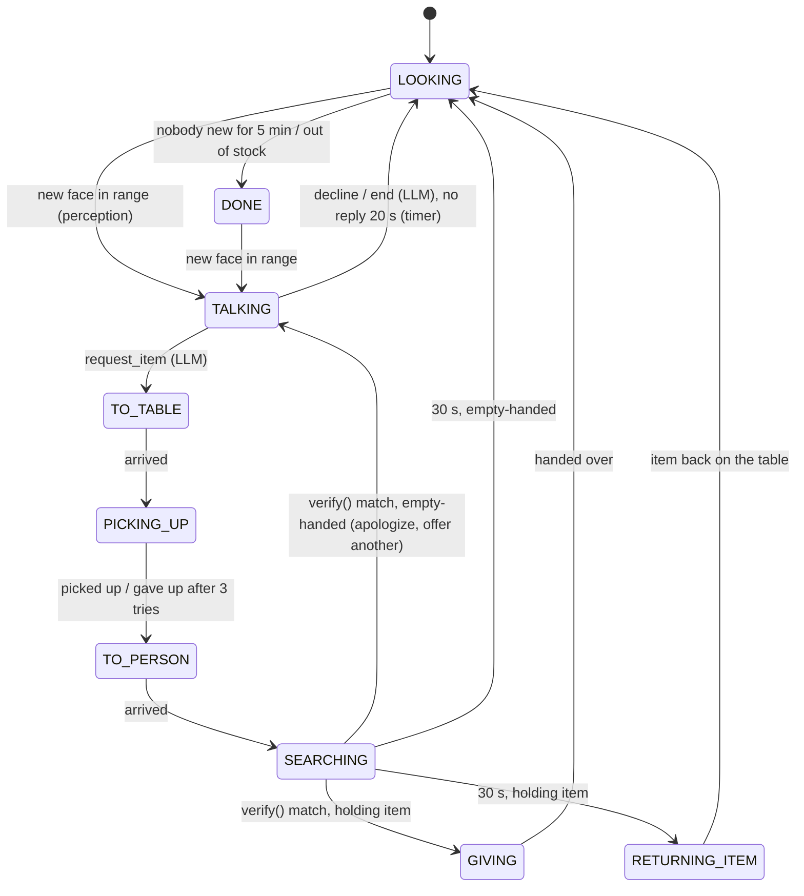

# Master plan: Stretch swag robot

The single place where we decide how the whole system works. **Decided** = agreed;
**Built** = implemented and tested in simulation; **Open** = still to answer.
Parked ideas live in `FUTURE_WORK.md`.

## 1. Goal

Stretch works an event on its own: it finds people it hasn't served, asks what they
want (pen / t-shirt / plushie), fetches it from its table, finds the person again and
hands it over. It keeps going until nobody new is around or it runs out of stock.

## 2. Handicaps (Decided)

These keep the problem solvable now; each can be lifted later.

1. **People may move, but the person being served is asked to stay put** ("please wait
   right here while I fetch it"). No following people.
2. **Starting a conversation:** the robot talks to any **new face within ~2.5 m**. It
   doesn't walk up to people.
3. **Finding the person again:** drive back to where they stood, then **spin in place and
   call their name** (people turn toward their name, which shows their face).
4. **Face recognition only.** No body re-identification. A person counts as "seen" only
   when their face is visible.
5. **Movement is limited to** wandering while looking for people, driving to the table
   (fixed position), and driving back to where the person stood. Everything else is
   spinning in place.

## 3. Principles (Decided)

1. **Code owns the state.** The state machine in code is the source of truth. The LLM
   never "remembers" anything; its prompt is rebuilt from the event log on every call.
2. **The LLM decides *what*; code decides *how*.** The LLM may fire only the transitions
   allowed in the current state; code rejects anything else. Skills retry in code and
   report `{success, reason}`; retry caps live in code.
3. **One event log.** Every state change, utterance, skill result and person update is
   appended once with a timestamp. Transcripts, prompts and eval data are built from it.
4. **Our own harness**, not a voice-agent framework.
5. **Replayable.** Every LLM call is logged with its exact prompt and output.

## 4. Where things run (Decided, Built)

```
Robot (ROS 2, all decisions)                         Mac (two plain services)
────────────────────────────                         ────────────────────────
state machine · event log · person registry          llama-server (LFM3 1.7B)
prompt builder · conversation engine ── HTTP ──────► OpenAI-compatible /v1/chat/completions
skills: drive, spin, pickup, handover
perception: camera → face cutouts + depth ── HTTP ─► face service: register / identify / verify
mic → streaming STT → /swag/heard                    (face embeddings live here, keyed by
/swag/say → streaming TTS → speaker                   the robot's person ids)
```

- **Only text and face cutouts cross the network.** No audio or video streaming.
- **The robot owns person ids.** It decides when someone is new and registers their face
  under that id; the Mac never invents ids.
- **If the Mac is unreachable,** a conversation ends (silently) after 5 failed LLM calls,
  and perception finds nobody, so the robot keeps wandering instead of acting on stale data.
  Open: a canned spoken line for this case.

### Mac face service API (Built: `mac-service/face_service.py`)

| Call | Body | Returns | Used in |
|---|---|---|---|
| `POST /faces/reset` | `{session}` | | robot startup |
| `POST /faces/register` | `{person_id, face}` | `{views}` | new person found; extra views while talking |
| `POST /faces/identify` | `{face}` | `{person_id or null, score}` | looking for new people |
| `POST /faces/verify` | `{person_id, face}` | `{match, score}` | searching for the target |

`face` = `{"embedding": [...]}` (simulator) or `{"image_jpeg_b64": ...}` (real camera,
needs a face model: returns 501 until one is chosen). Matching: cosine similarity, best of
up to 20 stored views per person, threshold 0.45 and a 0.08 margin over the runner-up.
Memory only.

## 5. State machine (Built: `core/states.py`)



| State | What the robot does |
|---|---|
| `LOOKING` | Spin 360° in 45° steps, then wander to a random spot in the event area; repeat |
| `TALKING` | Conversation (§6). Also re-registers the person's face as it talks (up to 6 views) |
| `TO_TABLE` | Drive to the table's fixed position |
| `PICKING_UP` | Grasp the item (up to 3 attempts) |
| `TO_PERSON` | Drive to 1 m from where the person stood |
| `SEARCHING` | Call their name, spin in 30° steps, re-call every 10 s, check faces with `verify` |
| `GIVING` | Say the handover line, hand over, a few seconds for "thank you" |
| `RETURNING_ITEM` | Drive to the table, put the item back (stock +1) |
| `DONE` | Wait at the table; still watches for new faces if there's stock |

### Triggers

Every arrow has exactly one kind of trigger:

| Trigger | Source | Notes |
|---|---|---|
| `new_person_found` | perception | `identify()` = unknown (or a person previously **missed**), within 2.5 m |
| `request_item`, `decline` | **LLM tool call** (`fetch_item`, `end_conversation`) | Only in `TALKING`; code checks the item is in stock |
| `no_response` | timer | 20 s with no reply at all after the robot spoke |
| `arrived` | navigation skill | |
| `picked_up` / `pickup_gave_up` | grasp skill | 3 attempts per fetch |
| `target_found` / `target_found_no_item` | perception | `verify(target)` match; robot drives up to them if they moved |
| `target_not_found` / `..._no_item` | timer | 30 s of searching; person marked **missed** |
| `item_given` | handover skill | |
| `no_new_people` | timer | 5 min without a new person |
| `out_of_stock` | stock check | |

### Gaps the original diagram didn't cover (now handled)

- **Pickup fails:** go back empty-handed, apologize, offer something else (the `fetch_item`
  result says "the grasp failed 3 times … you came back empty-handed"). After 2 failed
  fetches for the same person, apologize and say goodbye.
- **Target not found while holding the item:** put it back on the table.
- **A missed person turns up later:** treated like a new person, and the LLM asks if they
  still want their item.
- **Out of stock:** the LLM is only offered items in stock; at zero stock the robot goes to `DONE`.
- **Someone steps in front of the robot:** every drive pauses while a person is within 0.6 m
  ahead, and fails after 15 s blocked. This is a layer under the skills, not a state.
- **Someone talks to the robot mid-fetch:** ignored for now (no listening outside `TALKING`
  and `GIVING`). Open: should it say "I'll be right with you"?

## 6. LLM harness (Built: `core/prompt.py`, `core/conversation.py`, `core/llm.py`)

### Why it looks like an ordinary chat agent (Decided)

Our first harness used custom tags (`<listening>`, `<speaking>`, `[state: ...]` lines).
LFM3 couldn't use them: its listen/speak choice followed the order the options were
listed in, not the conversation. Small chat models are trained on one format: a system
prompt, user messages, assistant replies, tool calls and tool results. So the robot's
world is mapped onto exactly that, and nothing in the prompt mentions states or tags.

| Robot concept | What the model sees |
|---|---|
| Visitor speech | **user** message: their words, `...` where they paused |
| Robot speech | **assistant** turn calling `say_to_visitor(text)` (result: "Said.") |
| Visitor still mid-sentence | the model calls `wait_for_visitor()` |
| Visitor chose an item | the model calls `fetch_item(item, say)` |
| Visitor doesn't want anything | the model calls `end_conversation(say)` |
| What happened during a fetch | the **`fetch_item` tool result**, written when the robot is back |
| Current situation (who, holding what, stock) | the **system prompt**, in plain sentences |

**Every turn must be exactly one tool call** (`tool_choice: required`). With speech as free
text plus optional tools, LFM3 attached `fetch_item` to almost every reply (even "Which item
would you like?"); with `say_to_visitor` as a tool, that mistake mostly disappeared.

### What the model reads (real example, handover after a failed pickup)

```
system:    You are Stretch, a friendly robot at a tech event giving away free swag, one item per person. ...
           You're talking with Jeff. You have pens, t-shirts and plushies to give away. You don't have the
           pen: picking it up failed. Apologize to Jeff and ask if they'd like something else instead.
           The visitor's words come from speech recognition. ...
           Every turn, call exactly one tool:
           - say_to_visitor: ... - fetch_item: ... - end_conversation: ...
assistant: say_to_visitor("Hey! I'm Stretch, and I've got free goodies to give away. What should I call you?")
tool:      Said.
user:      I'm Jeff.
assistant: say_to_visitor("Nice to meet you, Jeff! You can have a pen right now.")   (known issue: nudges toward a pen)
tool:      Said.
user:      I think I'd like a pen, please.
assistant: fetch_item(item="pen", say="Great choice! Please wait right here while I get your pen.")
tool:      You walked to your table (8 seconds). You couldn't pick up the pen: the grasp failed 3 times
           (12 seconds). You went back to where Jeff was standing (12 seconds). You called out: "Jeff? I'm
           back!". You looked around and found Jeff, who is right in front of you now. You came back
           empty-handed: you don't have the pen.
→ model:   say_to_visitor("Oh no, I couldn't grab the pen. Sorry about that, Jeff! Would you like a
           t-shirt or a plushie instead?")
```

Rules for building it:
- **Fetch results** narrate the state and skill events since the call: durations computed by
  code, "slower than usual" when a step takes over 1.5× its usual time, failed attempts, the
  call-outs during the search. They **end on what the robot is holding**, because small
  models weigh the last sentence most (without it, the model said "here's your pen" after a
  failed pickup).
- **Only this person's conversation** is shown; other visitors never appear.
- **Fixed lines skip the LLM:** greetings, "Are you still there?", calling someone's name.
- **Tools offered depend on the state:** talking = all four; handover = `say_to_visitor`
  (+ `wait_for_visitor` for the "thank you!" afterwards).

### Code has the last word

Each check targets a mistake measured on the test set or seen in simulation:

| Check | Why |
|---|---|
| `fetch_item` item must be in stock | the model can't change stock |
| No `fetch_item` if its own line still asks "which…?" or lists several items | it fetched while asking |
| `fetch_item`'s line must tell them to wait; otherwise a fixed line is used | it said "Here is your pen!" as it left |
| Narrated waits ("Wait for the visitor to finish…") count as `wait_for_visitor` | |
| Names come from a code extractor ("I'm Jeff", "my name is…", a one-word answer to "what's your name?"), never from the model | as a tool argument it filled in "Visitor", "a" |

### When the LLM is called

- **Ticks** every 0.5 s while talking, once the visitor has paused ≥ 0.5 s and only if new
  words arrived. After a 2.5 s pause `wait_for_visitor` is withdrawn, so a wrong "wait"
  costs ~2 s, not a missed reply.
- **Events:** the handover line, apologies, "do you still want it?" for a missed person.
- **Mic muted while the robot speaks:** words heard then are dropped.

### Test set (`ros/stretch_swag/eval/run_eval.py`)

94 cases: Declan's 78 (`language-server/eval/cases.jsonl`) + 16 for cut-off sentences and
names, scored through the robot's real code path. LFM3 1.7B, 2–3 runs each:

| Harness | Score | Robot leaves for the wrong item |
|---|---|---|
| Custom tags (first version) | ~45% (10-case probe) | |
| Chat + free-text replies + optional tools | 64–73% | 14–26% |
| **Chat + one required tool per turn + code checks (current)** | **81%** | **~4%** |

Names: 100%. Remaining misses: waiting on a finished sentence (~7%, self-corrects after
2.5 s), not fetching when it should (~5%, it asks again). Typical call: ~0.75 s.

Lessons: examples written as text in the prompt get copied literally (30%); bulleted
rules that name a tool more often make it call that tool more; small models pick the
first-listed option when unsure.

## 7. ROS interface (Built: `ros/stretch_swag`)

| Topic | Type | Direction | Real source later | Cheat now |
|---|---|---|---|---|
| `/swag/heard` | String JSON `{text}` | in | streaming STT node | `sim_people` replies / `chat_console` |
| `/swag/say` | String JSON `{text, person_id, duration_s, final}` | out | → streaming TTS node | printed; `sim_people` listens |
| `/swag/faces` | String JSON `[{embedding or image_jpeg_b64, x, y, distance, bearing}]` | in | face detector + depth | `sim_people` (synthetic embeddings) |
| `/swag/obstacles` | String JSON `[[x, y]]` | in | lidar | `sim_people` |
| `/odom`, `/stretch/cmd_vel` | standard | in / out | Stretch driver | `fake_base` or the MuJoCo driver |
| `/aruco/marker_array` | MarkerArray | in | Stretch's `detect_aruco_markers` | our `aruco_detect` (colour only; MuJoCo) |
| `/scan_filtered` | LaserScan | in | Stretch's lidar | MuJoCo's simulated lidar |
| `/swag/state`, `/swag/status` | String / JSON | out | | |

All custom messages are JSON in `std_msgs/String` for now (no custom message package to build).

Two simulations: `sim.launch.py` (no physics, no camera: fast logic testing) and
`mujoco.launch.py` (MuJoCo with cutout people wearing badges: the robot's real perception chain,
lidar safety and search, at 2-3x real time).

On the real robot (`launch/robot.launch.py`): `/swag/faces` comes from `badge_faces` (ArUco badges),
`/swag/say` goes to `speaker_node` (Kokoro on the Mac, or espeak), `/swag/heard` from `chat_console`
(typed), and safety uses the lidar. See `STRETCH-TEST.md`.

## 8. Work streams

| # | Stream | Status | What's cheated now | Real version needs |
|---|---|---|---|---|
| 1 | **Path finding** to the table / person through a crowd | Straight-line go-to with odometry; **lidar safety stop** (a robot-wide corridor ahead, `/scan_filtered`); search = random turn toward open space, drive 0.8-2.5 m, look | No obstacle avoidance, no map; odometry frame = map | Map the room once, Nav2 + lidar localization, people as dynamic obstacles |
| 2 | **Finding / recognizing people** | Turn in place; walk up to the first new face (even far), confirm up close, talk. Search = call name + `verify`. **Real face recognition built**: `face_detect` (YuNet + SFace, OpenCV CPU) → `/swag/faces`; debug window `/swag/debug` shows everyone met | Badges (ArUco) still the default on the robot; sim faces need photos | Tune distance-from-face-size and thresholds on real people | Face detector on the robot (cutout + depth), face model in the Mac service |
| 3 | **Chatting** | Harness built and tested with the real LFM3 (81% on the test set; full loop in simulation) | Typed or scripted words; speech printed | Streaming STT + TTS nodes on `/swag/heard`, `/swag/say` |
| 4 | **Picking up objects** | **Goodie bags with rope loops** (`pick.py`, `pick_mode:=arm`): ArUco tag on each bag's label → line up beside it → gripper down over the loops → close, lift, carry; hand-over = open the gripper. Works in MuJoCo (retries a missed grasp) | Bags in a known row on the table's edge | Real bags measured; verify arm goals in navigation mode on the robot | Table layout, item slots, grasping (+ verify grasp) |
| 5 | **State tracking / triggers / logging** | Built: state machine, event log, registry, LLM log | | Tune timeouts on the real robot |

## 9. Models

| Job | Candidates | Notes |
|---|---|---|
| LLM | **LFM3 1.7B** (chosen, tested) | 81% on our test set, ~0.75 s per call. Next to try: Qwen 3.5 4B, or fine-tuning LFM3 on our format. |
| Streaming STT (untested) | Moonshine streaming (robot CPU), Kyutai STT 1B (Mac/MLX) | Prefer words that are final once emitted. |
| Streaming TTS (untested) | Kokoro (current), Pocket TTS (CPU, ~200 ms first audio) | |
| Face detection (untested) | YuNet, SCRFD, face-trained YOLO | Standard YOLO has no face class. |
| Face embeddings (untested) | SFace (light), ArcFace/InsightFace (stronger) | Goes in the Mac face service. |

## 10. Open questions

- Robot access: when can we benchmark STT/TTS/face detection on Stretch's computer?
- Physical items and table layout (bins / slots with fixed grasp poses?).
- Mic/speaker on Stretch: on-board echo cancellation (for barge-in)? Direction of arrival?
- Registry retention and consent for storing face embeddings.
- Should the robot acknowledge people who talk to it mid-fetch?
